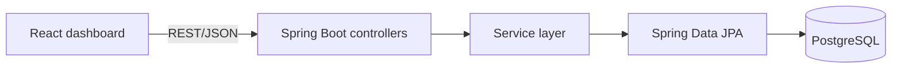

# Personal Finance Tracker

A full-stack finance dashboard for recording transactions, importing CSV data, and exploring spending summaries and trends.

## Features

- Create, list, and delete income and expense transactions
- Import transactions from CSV
- View income, expense, and net-balance summaries
- Explore expense totals by category
- Compare monthly income and expenses
- Generate rules-based observations about spending patterns
- Use a responsive React dashboard

## Tech stack

- **Backend:** Java 21, Spring Boot, Spring Data JPA, Hibernate
- **Frontend:** React, Vite, Axios, Recharts
- **Database:** PostgreSQL
- **Testing:** JUnit 5, Mockito
- **Build tools:** Gradle, npm

## Architecture



## Project structure

```text
.
├── src/main/java/com/finance/backend
│   ├── controller
│   ├── dto
│   ├── entity
│   ├── repository
│   └── service
├── src/main/resources/application.properties
├── src/test/java
├── frontend
│   └── src
│       ├── api
│       └── components
├── build.gradle
└── .env.example
```

## Local setup

### Prerequisites

- Java 21
- PostgreSQL
- Node.js 20 or newer

### 1. Configure PostgreSQL

Create a local database:

```sql
CREATE DATABASE finance_tracker;
```

Set the required database password and any optional overrides in your shell. Do not commit real credentials.

PowerShell:

```powershell
$env:DB_PASSWORD = "your-local-postgres-password"
```

Bash:

```bash
export DB_PASSWORD="your-local-postgres-password"
```

Other supported variables are documented in [`.env.example`](.env.example). Spring Boot reads the variables from the process environment; it does not automatically load the `.env` file.

### 2. Run the backend

PowerShell:

```powershell
.\gradlew.bat bootRun
```

Bash:

```bash
./gradlew bootRun
```

The API runs at `http://localhost:8080` by default.

### 3. Run the frontend

```bash
cd frontend
npm install
npm run dev
```

The dashboard runs at `http://localhost:5173`. Vite proxies `/api` requests to the local backend.

## API

| Method | Endpoint | Purpose |
| --- | --- | --- |
| `POST` | `/api/transactions` | Create a transaction |
| `GET` | `/api/transactions` | List transactions |
| `DELETE` | `/api/transactions/{id}` | Delete a transaction |
| `POST` | `/api/transactions/upload` | Import a CSV file |
| `GET` | `/api/dashboard/summary` | Get income, expense, and balance totals |
| `GET` | `/api/dashboard/category-breakdown` | Get expense totals by category |
| `GET` | `/api/dashboard/monthly-trend` | Get monthly income and expense totals |
| `GET` | `/api/dashboard/insights` | Get rules-based spending observations |

Example transaction:

```json
{
  "amount": 125.50,
  "type": "EXPENSE",
  "category": "Groceries",
  "description": "Weekly groceries",
  "transactionDate": "2026-10-18",
  "source": "MANUAL"
}
```

CSV format:

```csv
amount,type,category,description,transactionDate,source
5000,INCOME,Salary,Monthly salary,2026-10-01,CSV
125.50,EXPENSE,Groceries,Weekly groceries,2026-10-18,CSV
```

## Verification

Run backend unit tests:

```powershell
.\gradlew.bat test
```

Run frontend checks:

```bash
cd frontend
npm run lint
npm run build
```

## Roadmap

- Add database migrations with Flyway
- Add integration tests with Testcontainers
- Add authentication and user-specific data
- Add filtering, pagination, and recurring transactions
- Add Docker Compose and CI/CD
- Deploy a live demonstration environment
